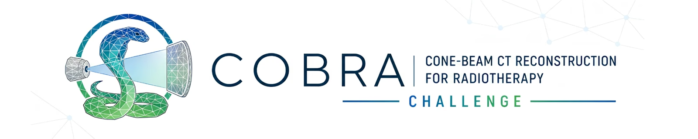

<!-- PROJECT SHIELDS -->
[![Contributors][contributors-shield]][contributors-url]
[![Forks][forks-shield]][forks-url]
[![Stargazers][stars-shield]][stars-url]
[![Issues][issues-shield]][issues-url]
[![Apache-2.0][license-shield]][license-url]


<!-- PROJECT LOGO -->
<br />
<p align="center">
  <a href="https://cobra2026.grand-challenge.org/">
    
  </a>

  <p align="center">
    Evaluation docker to assess the submissions in the
    <a href="https://cobra2026.grand-challenge.org/"><strong>COBRA2026 Grand Challenge</strong></a>
    <br />
    <a href="https://github.com/cobra-challenge-2026/evaluation"><strong>Explore the docs »</strong></a>
    <br />
    <br />
    <a href="https://github.com/cobra-challenge-2026/evaluation/issues">Report Bug</a>
    ·
    <a href="https://github.com/cobra-challenge-2026/evaluation/issues">Request Feature</a>
  </p>
</p>

<!-- TABLE OF CONTENTS -->
## Table of Contents

* [Goal](#goal)
* [Metrics](#metrics)
* [Ranking](#ranking)
* [Submission format](#submission-format)
* [Getting Started](#getting-started)
  * [Dependencies](#dependencies)
  * [Installation](#installation)
* [Ground-truth embeddings](#ground-truth-embeddings)
* [Uploading to Grand Challenge](#uploading-to-grand-challenge)
* [Configuration](#configuration)
* [Contributing](#contributing)
* [License](#license)
* [Contact](#contact)


<!-- ABOUT THE PROJECT -->
## Goal

The source code of the evaluation container for the
[COBRA2026 challenge](https://cobra2026.grand-challenge.org/), built on the
[Grand Challenge challenge pack](https://github.com/DIAGNijmegen/demo-challenge-pack).

For every submitted volume the container computes classic image-similarity
metrics and two perceptual similarity scores based on pre-trained medical
foundation models (MedSigLIP and FlexiCT-3D).


<!-- METRICS -->
## Metrics

The central difficulty in evaluating CBCT reconstruction is the **absence of a perfectly aligned ground truth**. A clinical planning CT and the CBCT it is compared against are acquired days, sometimes weeks, apart, so the underlying anatomy has genuinely changed. Deformable image registration (using Elastix with an Impact loss) warps the planning CT onto the CBCT anatomy to narrow this gap, but residual mismatch always remains, particularly in deformable soft tissue. Synthetic data sidesteps this by providing known ground truth, but a simulation can never fully reproduce the artifacts of a real scan.

COBRA's evaluation is built around this reality. Rather than trusting any single metric against an imperfect reference, each reconstruction is scored across **three complementary metric groups**, each chosen to capture something the others cannot.

Where indicated, metrics are computed within the field of view (FOV) provided with each case (`fov_cbct.mha`); the code that generates this evaluation region is distributed with the data.

### The metric groups

#### 1. Intensity accuracy -- *vs. deformed planning CT*

These metrics ask whether the reconstructed Hounsfield units are correct, which is the foundation of any downstream **dose calculation**, since dose engines read tissue attenuation directly from HU. They are computed against the deformably registered planning CT within the FOV mask.

* **Mean Absolute Error (MAE)**: the mean absolute voxel-wise difference in **Hounsfield units**. Lower is better. The most direct measure of HU fidelity.
* **Peak Signal-to-Noise Ratio (PSNR)**: in **dB**, relative to the typical HU range (data range 4095). Higher is better. Rewards reconstructions that are globally faithful and penalizes large intensity errors.

*Limitation of this group: it compares against an imperfectly aligned CT, so some residual error reflects registration mismatch rather than reconstruction quality. This is why the next two groups exist.*

#### 2. Geometric consistency -- *vs. reconstructed CBCT*

These metrics check that the reconstruction is **spatially faithful to the original CBCT anatomy**, catching distortion, warping, or hallucinated structure independently of absolute intensity. Because they compare the reconstruction against the CBCT it was derived from (reconstructed via RTK for real and simulated cases), they are unaffected by the CT-CBCT registration mismatch above.

* **Normalized Cross-Correlation (NCC)**: measures linear intensity correspondence and structural alignment (Pearson correlation). Higher is better.
* **Normalized Mutual Information (NMI)**: measures shared information between images without assuming a linear intensity relationship, which makes it robust to the intensity differences expected between a reconstruction and its source CBCT (256 histogram bins). Higher is better.

Both are computed over the whole volume. As the reconstructed CBCT can carry artifacts such as saturation and streak artifacts, these metrics will also reward images that reproduce those artifacts. The combination of groups is therefore important, which leads to the third group.

#### 3. Perceptual similarity -- *vs. deformed planning CT*

Intensity and geometry metrics can both look healthy while a reconstruction still carries **streaking, residual scatter shading, or texture artifacts** that would make it clinically unusable. Deep feature embeddings are sensitive to exactly these failures. Each metric is the **cosine similarity** between embeddings of the reconstruction and the reference (1.0 = identical embedding).

* **CS_MedSigLIP**: cosine similarity of embeddings from the frozen MedSigLIP vision encoder ([`google/medsiglip-448`](https://huggingface.co/google/medsiglip-448)), computed on **axial slices** and averaged across all slices to give the per-case score. Each slice is clipped to three CT windows (HU -1024..1024, -135..215, 0..80), stacked as an RGB image, resized to **448 x 448** (bicubic) and normalized per the encoder's specification. Higher is better.
* **CS_FlexiCT**: cosine similarity of embeddings from the frozen [FlexiCT-3D](https://github.com/ricklisz/FlexiCT) encoder, computed on the **whole volume**. The volume is clipped to -1000..1000 HU, z-scored, resized to a **128 x 128 x 128** cube (trilinear) and embedded once. Higher is better.

For the perceptual metrics, everything outside the FOV mask is set to air (-1024 HU) before embedding. Both encoders run in **fp16** (`EMBED_DTYPE=float16`); the reference embeddings are precomputed with the same setting.

> **The three groups at a glance**
>
> | Group | Metrics | Compared against | Captures |
> | :--- | :--- | :--- | :--- |
> | **Intensity accuracy** | MAE (HU), PSNR (dB) | Deformed planning CT (inside FOV mask) | HU fidelity for dose calculation |
> | **Geometric consistency** | NCC, NMI | Reconstructed CBCT | Spatial fidelity, distortion |
> | **Perceptual similarity** | CS_MedSigLIP, CS_FlexiCT | Deformed planning CT | Artifacts the other two miss |

The three groups are deliberately complementary: intensity is what dose calculation needs but is hostage to registration error; geometry sidesteps registration but rewards artifacts; perceptual similarity catches the artifacts that slip past both. Only a reconstruction that satisfies all three is clinically convincing.

Every prediction (real and simulated) is scored separately. A prediction must have exactly the same array shape as the ground-truth volume of its case; otherwise it fails.

The container writes six values per case (`mae`, `psnr`, `nmi`, `ncc`, `cs_medsiglip`, `cs_flexict`) and their means over all cases to `metrics.json`.


<!-- SUBMISSION FORMAT -->
## Submission format

For every case, participants submit **two** reconstructed CBCT volumes: one reconstructed from the **real** projections and one reconstructed from the **simulated** projections of that case. Files are named `<CASE>_cbct_real.mha` and `<CASE>_cbct_sim.mha`, where `<CASE>` is the case id (upper case, e.g. `A008`):

```
A008_cbct_real.mha
A008_cbct_sim.mha
B046_cbct_real.mha
B046_cbct_sim.mha
...
```

Both volumes of a case are evaluated against the same ground-truth folder `ground_truth/<CASE>/`. The case id is the part of the file name before the first underscore. Each prediction must have exactly the same array shape as the ground-truth volume of its case.

In the prediction-only mode of this container (no `predictions.json`), a sanity check requires that the submitted case ids match the ground-truth folders, with two predictions per case.


<!-- GETTING STARTED -->
## Getting Started

### Dependencies

* [Docker](https://docs.docker.com/) with an NVIDIA GPU and the [NVIDIA Container Toolkit](https://docs.nvidia.com/datacenter/cloud-native/container-toolkit/) (the evaluation runs on the GPU).
* A Hugging Face account that has accepted the [MedSigLIP license](https://huggingface.co/google/medsiglip-448) (the model is gated).
* Python with `huggingface_hub` and `gdown` to download the model weights (or run `download_models.py` in any environment that has `requirements.txt` installed).

### Installation

**1. Clone the repo**
```sh
git clone https://github.com/cobra-challenge-2026/evaluation.git
cd evaluation
```

**2. Download the model weights**

Accept the MedSigLIP license on Hugging Face and log in (`huggingface-cli login`, or set `HF_TOKEN`). Then:
```sh
cd pre_download
python download_models.py
cd ..
```
This creates `pre_download/model_weights/flexict/3D_final_model.pth` and `pre_download/model_weights/medsiglip/`; the Dockerfile copies them into the image. The container itself runs fully offline.

**3. Prepare the data**

* **Ground truth**, one folder per case (case ids are upper case, e.g. `A009`):
  ```
  ground_truth/
  └── <CASE>/
      ├── ct_def_masked.mha     deformed planning CT
      ├── cbct_rtk.mha          RTK-reconstructed CBCT
      ├── fov_cbct.mha          FOV mask of the CBCT
      └── gt_embeddings.npz     precomputed reference embeddings (see below)
  ```
* **Input** (`test/input/`): the predictions to evaluate, as `.mha` files, two per case: one
  reconstructed from the real projections (`_cbct_real`) and one from the simulated
  projections (`_cbct_sim`). For example, for the cases `A008` and `B046`:
  ```
  test/input/
  ├── A008_cbct_real.mha
  ├── A008_cbct_sim.mha
  ├── B046_cbct_real.mha
  └── B046_cbct_sim.mha
  ```

**4. Build and run**

The first command builds the image and runs it on `test/input`; the result is written to `test/output/metrics.json`:
```sh
./do_test_run.sh
```
or step by step:
```sh
./do_build.sh      # docker build -t cobra2026-evaluation
docker run --rm --gpus all --platform=linux/amd64 --network none \
    -v /full/path/to/input:/input:ro \
    -v /full/path/to/output:/output \
    -v /full/path/to/ground_truth:/opt/ml/input/data/ground_truth:ro \
    cobra2026-evaluation
```

The output is written to `/output/metrics.json`: a list of per-case results (in completion order) and the `aggregates`.


<!-- GROUND-TRUTH EMBEDDINGS -->
## Ground-truth embeddings

The reference embeddings of the (fixed) ground truth are computed once and shipped inside the ground-truth tarball as `<CASE>/gt_embeddings.npz`, so that the evaluation does not have to embed the reference again for every submission. **They must be present**: the evaluation expects them for each case.

Regenerate them whenever the ground truth, the models or the precision change:

1. In the `Dockerfile`, uncomment the line that copies `precompute_ground_truth_embeddings.py` into the image.
2. Run
   ```sh
   ./do_precompute_ground_truth_embeddings.sh
   ```
   which embeds every case under `ground_truth/` on the GPU and writes `gt_embeddings.npz` next to the images.
3. Build the tarball so the case folders are at its top level:
   ```sh
   tar -czf ground_truth.tar.gz -C ground_truth .
   ```


<!-- UPLOAD -->
## Uploading to Grand Challenge

1. Save the image: `./do_save.sh` (writes `cobra2026-evaluation_<timestamp>.tar.gz`).
2. Upload it as the evaluation method of the phase.
3. Upload `ground_truth.tar.gz` under *Phase settings > Ground Truths*. It is extracted to `/opt/ml/input/data/ground_truth/` at runtime.

See also the Grand Challenge [documentation](https://grand-challenge.org/documentation/automated-evaluation/).


<!-- CONFIGURATION -->
## Configuration

Environment variables (defaults set in the `Dockerfile`):

| Variable | Default | Meaning |
|---|---|---|
| `EMBED_DTYPE` | `float16` | model precision (`float16` or `float32`); must match the precision of `gt_embeddings.npz` |
| `MEDSIGLIP_LOCAL_DIR` | `/opt/app/model_weights/medsiglip` | folder with the MedSigLIP weights |
| `GRAND_CHALLENGE_MAX_WORKERS` | `1` | number of parallel worker processes (each loads its own copy of both models) |
| `INPUT_DIRECTORY`, `OUTPUT_DIRECTORY`, `GROUND_TRUTH_DIRECTORY`, `MODEL_WEIGHTS_DIR` | container paths | override the default locations when running outside the container |


<!-- RANKING -->
## Ranking

Submissions are ranked with the **RankThenMean** procedure:

1. **Average per metric.** For each metric, compute the mean value over all test patients for each submission.
2. **Rank per metric.** Rank these averages across all submissions, from **1 (best)** to **n (worst)**.
3. **Average within each group.** Average the ranks within each of the three metric groups (intensity, consistency, similarity).
4. **Average across groups.** Average the three group ranks to obtain the final score.

This gives **every group equal weight** and avoids arbitrary normalization between metrics with different scales and units (e.g. MAE in Hounsfield units versus the unitless NMI). The approach was validated in the SynthRAD challenge series, where it proved stable and robust to outliers without normalization.

**Tie-breaking.** If two submissions share the same final score, the team with the superior rank on the synthetic data subset ranks higher, as the synthetic data is the most controlled scenario and the only one with true, perfectly aligned ground truth.

This container computes the per-case metrics and their means; the RankThenMean ranking is applied to these aggregated results.

### Metrics by phase

The same metric groups and ranking procedure are used in both phases; the validation phase serves as feedback and rehearsal, and the test phase determines the official result.

| | Validation phase | Test phase |
| :--- | :--- | :--- |
| **Intensity** | MAE, PSNR | MAE, PSNR |
| **Consistency** | NCC, NMI | NCC, NMI |
| **Perceptual** | --- | CS_MedSigLIP, CS_FlexiCT |
| **Evaluation set** | Validation set (equal split real / synthetic) | Test set (equal split real / synthetic) |
| **Ranking** | RankThenMean (feedback only) | RankThenMean (official ranking) |
| **Visibility** | Open leaderboard | Final ranking after the test phase closes |


<!-- CONTRIBUTING -->
## Contributing

Contributions are what make the open source community such an amazing place to learn, inspire, and create.
Any contributions you make are **greatly appreciated**.

1. Fork the Project
2. Create your Feature Branch (`git checkout -b feature/AmazingFeature`)
3. Commit your Changes (`git commit -m 'Add some AmazingFeature'`)
4. Push to the Branch (`git push origin feature/AmazingFeature`)
5. Open a Pull Request


<!-- LICENSE -->
## License

Distributed under the Apache License 2.0. See `LICENSE` for more information.

Third-party components and model licenses are listed in `NOTICE`. In particular:
the parts of `similarity_models.py` derived from DINOv3 remain under the
[DINOv3 License](third_party_licenses/DINOv3_LICENSE.txt); the FlexiCT code is MIT-licensed while its released
checkpoints are CC BY-NC-ND 4.0 (research use); MedSigLIP is a gated model under Google's terms.
The model weights are not part of this repository.


<!-- CONTACT -->
## Contact

Lukas Zimmermann, Medical University of Vienna - lukas.a.zimmermann@meduniwien.ac.at  
Julius Arnold, Medical University of Vienna - julius.arnold@meduniwien.ac.at

Project Link: [https://github.com/cobra-challenge-2026/evaluation](https://github.com/cobra-challenge-2026/evaluation)


<!-- MARKDOWN LINKS & IMAGES -->
[contributors-shield]: https://img.shields.io/github/contributors/cobra-challenge-2026/evaluation.svg?style=flat-square
[contributors-url]: https://github.com/cobra-challenge-2026/evaluation/graphs/contributors
[forks-shield]: https://img.shields.io/github/forks/cobra-challenge-2026/evaluation.svg?style=flat-square
[forks-url]: https://github.com/cobra-challenge-2026/evaluation/network/members
[stars-shield]: https://img.shields.io/github/stars/cobra-challenge-2026/evaluation.svg?style=flat-square
[stars-url]: https://github.com/cobra-challenge-2026/evaluation/stargazers
[issues-shield]: https://img.shields.io/github/issues/cobra-challenge-2026/evaluation.svg?style=flat-square
[issues-url]: https://github.com/cobra-challenge-2026/evaluation/issues
[license-shield]: https://img.shields.io/badge/License-Apache_2.0-blue.svg?style=flat-square
[license-url]: https://github.com/cobra-challenge-2026/evaluation/blob/main/LICENSE
